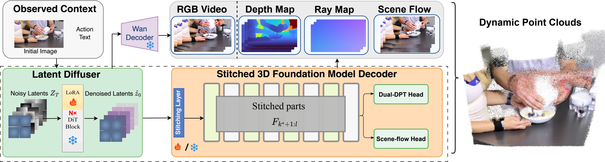

<h1 align="center">Plan4D: Generative Plannable 4D Worlds</h1>

<p align="center">
  <a href="https://fogradio.github.io/">Hangwei Zhang</a><sup>1,2</sup> &nbsp;
  <a href="https://scholar.google.com/citations?user=QKTF2UQAAAAJ">Rujing Dang</a><sup>2</sup> &nbsp;
  <a href="https://www.researchgate.net/scientific-contributions/Ruimin-Lin-2338212314">Ruimin Lin</a><sup>2</sup> &nbsp;
  <a href="https://scholar.google.com/citations?user=zCljkooAAAAJ">Jiahong Wu</a><sup>2,&dagger;</sup> &nbsp;
  <a href="https://cxxgtxy.github.io/">Xiangxiang Chu</a><sup>2</sup> &nbsp;
  <a href="https://physicalvision.github.io/people/~chuanxia">Chuanxia Zheng</a><sup>1,&dagger;</sup>
</p>

<p align="center">
  <sup>1</sup> PVG, Nanyang Technological University<br>
  <sup>2</sup> AMAP, Alibaba Group<br>
  <sup>&dagger;</sup> Corresponding authors
</p>

<p align="center">
  <a href="https://fogradio.github.io/plan4d-project/"><b>Project Page</b></a> &middot;
  <a href="https://arxiv.org/abs/2611.26516"><b>Paper</b></a> &middot;
  <a href="https://huggingface.co/GD-ML/plan4d/tree/main"><b>Models</b></a>
</p>

**Plan4D turns an observed scene and a text-specified action into a future video
and a dynamic 3D world.** A video generator and a geometry decoder share the
same latent trajectory, producing synchronized RGB, depth, camera parameters,
point clouds, and scene flow.

## Method

Plan4D connects the generative prior of **LongCat-Video** to the geometric
representation of **Depth Anything 3 (DA3)** through a compact latent-to-token
stitching module. Training proceeds in three stages:

1. **Learn motion.** Train a scene-flow head on frozen DA3 features to predict
   forward 3D displacement while preserving the pretrained geometry branches.
2. **Connect video and geometry.** Map Wan VAE latents into a selected DA3
   feature layer, then calibrate the stitched decoder with geometric labels
   and distillation from an independent RGB-based DA3 teacher.
3. **Make generation geometry-aware.** Use the frozen stitched decoder as a
   differentiable geometry critic while adapting the video DiT with LoRA.

At inference, the Wan VAE and stitched DA3 decoder read the same denoised
latents. No separate reconstruction pass over generated RGB frames is needed.

<p align="center">
  
  <br>
  <em>One latent trajectory, synchronized appearance, geometry, and motion.</em>
</p>

## Repository

| Path | Contents |
| --- | --- |
| `configs/` | One configuration per training stage, plus shared Accelerate settings |
| `scripts/` | One train/infer shell pair per stage, one full-pipeline inference shell, and a shared training launcher |
| `Depth-Anything-3/` | DA3, the scene-flow head, dataset adapters, and head training |
| `models/` | Latent-to-token stitching and the DA3 geometry decoder |
| `plan4d/` | Shared geometry interfaces, losses, and point-cloud utilities |
| `DiffSynth-Studio/` | LongCat/Wan runtime, joint training, and generation |
| `data/`, `utils/` | Manifests, preprocessing, checkpoint handling, and supervision |
| `evaluation/` | Dataset-specific reconstruction, depth, camera, and scene-flow benchmarks |

The publication tree contains no test suites, experiment snapshots, weights,
datasets, or generated outputs. Dataset-specific evaluators remain separate
because their annotation formats and metrics differ; training settings and
inference launch variants are consolidated.
DA3 architecture presets are retained for pretrained-weight compatibility;
they define different model variants, not duplicate training-stage settings.

## Installation

Use Python 3.10 or newer with compatible PyTorch, torchvision, and CUDA builds.
The integration environment uses Python 3.10 and PyTorch 2.6.0+cu124.

```bash
python -m pip install -r requirements.txt
python -m pip install -e ./Depth-Anything-3 --no-deps
python -m pip install -e ./DiffSynth-Studio --no-deps
export PYTHONPATH="$PWD:$PWD/Depth-Anything-3:$PWD/Depth-Anything-3/src:$PWD/DiffSynth-Studio${PYTHONPATH:+:$PYTHONPATH}"
```

Run subsequent commands from the repository root. `requirements-optional.txt`
lists optional dependencies: TensorFlow/TFDS for MOVi-F, Open3D and pycolmap for
evaluation, DeepSpeed for alternative distributed setups, and gsplat for DA3
Gaussian rendering. These are not all required for the core Plan4D path.
The default launcher uses Accelerate with one process, or multi-GPU DDP when
`--num-processes` is greater than one. Memory requirements depend on resolution,
clip length, trainable parameters, and the selected distributed strategy.

## Weights

### Plan4D Checkpoints

Download the **two checkpoint files** from
[Hugging Face](https://huggingface.co/GD-ML/plan4d/tree/main). Place them under
`checkpoints/plan4d/` without renaming them:

```text
checkpoints/plan4d/
  Stitched_Decoder.pth
  VDM_LoRA.safetensors
```

| File | Contents | Used by |
| --- | --- | --- |
| `Stitched_Decoder.pth` | Latent-to-token projection, full stitched DA3 parameters, trained scene-flow head, and special tokens | Stitched reconstruction and the complete pipeline; its head can also be loaded into raw DA3 |
| `VDM_LoRA.safetensors` | Rank-32 LoRA weights for the LongCat video DiT | Joint-model and complete-pipeline inference |

The files are inference/fine-tuning weights, not
optimizer-state checkpoints for exact training resumption. No download script
is required.

### Upstream Weights

The two Plan4D files do **not** include the base LongCat DiT, text encoder,
tokenizer, Wan VAE, or the pretrained DA3 bundle. Prepare the matching
[LongCat-Video](https://huggingface.co/meituan-longcat/LongCat-Video),
[Depth Anything 3](https://github.com/ByteDance-Seed/Depth-Anything-3), and
Wan 2.1 VAE weights separately. The recommended local layout is:

```text
checkpoints/
  plan4d/
    Stitched_Decoder.pth
    VDM_LoRA.safetensors
  da3/{config.json,model.safetensors}
  longcat/dit/
  longcat/text_encoder/
  longcat/tokenizer/
  longcat/vae/{config.json,diffusion_pytorch_model.safetensors}
  Wan2.1_VAE.safetensors
```

The DiffSynth pipeline uses `Wan2.1_VAE.safetensors`; stitched reconstruction
uses the Diffusers-format `longcat/vae/` directory. Both must represent the
matching Wan 2.1 VAE. The current loader also expects the giant/anyview DA3
pretrained bundle, even though the stitched file includes fine-tuned DA3 weights.
The reference setup uses `DA3NESTED-GIANT-LARGE`; the stitched decoder loads
its giant anyview branch. Keep the upstream `config.json` with the matching
`model.safetensors` rather than substituting the scene-flow-only YAML preset.

### Release Settings

The decoder file does not bundle a training-arguments sidecar. Use the release
settings explicitly, as in the inference commands below:

- Injection layer: `enc_blocks_1`.
- Projection: `conv3d_k5x3x3_o1536_s1x2x2_p2x1x1`.
- DA3 reference view: `first`; resolution: `504`.
- Decoder weights: full stitched parameters, detected from the checkpoint.
- Scene-flow architecture: `da3-giant-sceneflow`; head weights are embedded.
- Video LoRA: rank `32`, alpha `32`, with the default LongCat target modules.

There is no separate `scene_flow_head.bin` in the release. Raw-DA3 inference
can read the embedded head directly from `Stitched_Decoder.pth`. This uses the
head from the calibrated decoder, not a separately released stage-1 checkpoint.
For stitched or joint inference, leave the standalone head override unset so
the decoder restores its own head.

All inference examples pass the release filenames explicitly. Existing CLI and
environment-variable overrides remain available for custom training outputs;
no checkpoint conversion, renaming, or extra metadata file is required.

## Shell Entry Points

| Stage | Training | Inference |
| --- | --- | --- |
| 1: DA3 scene flow | `scripts/train_scene_flow.sh` | `scripts/infer_scene_flow.sh` |
| 2: Stitched decoder | `scripts/train_stitching.sh` | `scripts/infer_stitching.sh` |
| 3: Joint generation | `scripts/train_joint.sh` | `scripts/infer_joint.sh` |
| Complete RGB + geometry pipeline | Not applicable | `scripts/infer_pipeline.sh` |

These seven shell scripts are the supported workflow entry points. They reuse
the Python implementations and do not duplicate dataset-specific variants.
All scripts locate the repository automatically and run from its root;
relative arguments therefore resolve from the repository root. Set
`PYTHON_BIN` to select a Python executable and `NUM_PROCESSES` for training
(default: 1). Native CLI arguments are forwarded unchanged, and explicit
arguments override the shell defaults. Use `--help` on each entry point.

Inference paths can also be set with `DA3_MODEL_PATH`, `SCENE_FLOW_HEAD_PATH`
(stage 1, including the released decoder file), `STITCHED_DECODER_PATH`,
`WAN_VAE_PATH` (Diffusers directory),
`LONGCAT_WEIGHT_ROOT`, and `LONGCAT_VAE_FILE` (converted safetensors).
Stage 3 accepts either `DIT_LORA_PATH` or `DIT_CHECKPOINT_PATH`; an explicit
DiT CLI option takes precedence over these environment variables.

## Data Preparation

Keep data under `datasets/` and JSONL manifests under `manifests/`, or configure
external paths. Edit dataset roots and enabled datasets before launching.
The default example configurations do not train on held-out test splits.

Build scene-flow manifests with the native DA3 configuration:

```bash
python Depth-Anything-3/training/build_scene_flow_manifest.py \
  --config ../configs/scene_flow.yaml --output-dir ../manifests/scene_flow \
  --movi-f-splits train
python build_stitching_manifest.py \
  --config configs/stitching.yaml --output-dir manifests/stitching
```

The scene-flow configuration resolves dataset, weight, and training-output
paths relative to `Depth-Anything-3/`, including its manifest-builder output
directory. The launcher and stitching manifest builder resolve paths from the
repository root.

Scene-flow adapters cover PointOdyssey, BlinkVision, Virtual KITTI2,
OmniWorld, Dynamic Replica, and MOVi-F. For joint training, supply action/video
manifests such as OmniWorld and Action100M. See
[the DA3 data contract](Depth-Anything-3/training/README.md) and the relevant
manifest builder's `--help` for annotation requirements and dataset selection.

## Training

| Stage | Configuration | Trainable component |
| --- | --- | --- |
| 1: Scene flow | `configs/scene_flow.yaml` | Scene-flow head on frozen DA3 |
| 2: Stitching | `configs/stitching.yaml` | Latent projection and selected DA3 decoder parameters |
| 3: Joint | `configs/joint.yaml` | Video DiT LoRA with the stitched decoder frozen |

```bash
NUM_PROCESSES=4 bash scripts/train_scene_flow.sh
NUM_PROCESSES=4 bash scripts/train_stitching.sh
NUM_PROCESSES=4 bash scripts/train_joint.sh
```

These are sequential stages, not concurrent jobs. The training YAMLs are
from-scratch recipes: after each stage, update the next configuration with
the produced checkpoint. Their intermediate filenames are not additional
files in the two-file Hugging Face release. Configure
`CUDA_VISIBLE_DEVICES` to select devices. Preview any launch without loading
models or data using `--dry-run`. Pass native training arguments after `--`:

```bash
bash scripts/train_stitching.sh --dry-run
bash scripts/train_scene_flow.sh -- --resume /path/to/checkpoint
bash scripts/train_joint.sh -- --learning_rate 5e-5
```

For injection-layer selection, use `find_layer_for_stitching.py --help`.
The retained search implementation extracts paired Wan/DA3 features and fits
the projection. Set `stitching_layer_location` and `initialization_weight_path`
in `configs/stitching.yaml` from its results. A null initialization path starts
the projection from scratch; it does not reproduce the fitted initialization.

The stitched decoder supports `distill`, `gt`, and `hybrid` training. Joint
training defaults to distillation, with raw DA3 targets computed from the
ground-truth RGB clip. The published joint configuration uses DiT LoRA;
full-parameter training remains available through the native trainer options
without a separate duplicate launcher. Adjust shared `configs/accelerate.yaml`
for sharded training when DDP does not fit the available memory.

To initialize joint fine-tuning from the release, set
`stitched_decoder_checkpoint_path` in `configs/joint.yaml` to
`checkpoints/plan4d/Stitched_Decoder.pth` and use the release settings above.
Distillation still requires an independently initialized raw DA3 teacher and
head: `da3_scene_flow_head_checkpoint_path` can point to the released decoder
to load its head into that separate teacher, or to your own stage-1 head.
Loading a model checkpoint is not equivalent to restoring optimizer/scheduler
state for an exact training resume.

## Inference

### Stage 1: DA3 Scene Flow

Run the frozen DA3 backbone with the scene-flow head embedded in the released
decoder, on an existing video or image sequence:

```bash
bash scripts/infer_scene_flow.sh \
  --video_path /path/to/video.mp4 \
  --scene_flow_head_checkpoint_path checkpoints/plan4d/Stitched_Decoder.pth \
  --output_dir outputs/scene_flow_demo
```

The head in `Stitched_Decoder.pth` has undergone stage-2 stitched training;
it is not the stage-1 head obtained by training only the scene-flow head with
all existing DA3 parameters frozen.

Use `--image_dir /path/to/frames` instead of `--video_path` for image input.
Outputs include depth, cameras, point clouds, and `exports/scene_flow.npz`
with a `scene_flow` array of shape `[T, H, W, 3]` in the first camera basis.
For a head trained separately in stage 1, replace the checkpoint argument with
its head `.bin` or `.safetensors` file.

### Stage 2: Stitched Geometry

Encode an existing video or frame directory with the Wan VAE, then decode
geometry with the trained stitched DA3 decoder and its scene-flow head:

```bash
bash scripts/infer_stitching.sh \
  --input_path /path/to/video.mp4 \
  --checkpoint_path checkpoints/plan4d/Stitched_Decoder.pth \
  --stitching_layer_location enc_blocks_1 \
  --stitching_layer_config conv3d_k5x3x3_o1536_s1x2x2_p2x1x1 \
  --da3_ref_view_strategy first \
  --resolution 504 --feedforward_resolution 504 --max_frames 81 \
  --output_dir outputs/stitching_demo
```

The head is restored from the stitched checkpoint. Use
`--da3_scene_flow_head_checkpoint_path` only to supply a separate trained head.
This stage reconstructs the input clip; it does not run the video DiT.

### Stage 3: Joint Model

Generate RGB and geometry using the jointly trained video model:

```bash
bash scripts/infer_joint.sh \
  --dit_lora_path checkpoints/plan4d/VDM_LoRA.safetensors \
  --stitched_decoder_checkpoint_path checkpoints/plan4d/Stitched_Decoder.pth \
  --stitching_layer_location enc_blocks_1 \
  --da3_ref_view_strategy first \
  --num_frames 81 --max_frames 81 \
  --dit_lora_rank 32 --dit_lora_alpha 32 \
  --prompt "A person moves an object across a table." \
  --condition_path /path/to/first_frame.png \
  --output_dir outputs/joint_demo
```

The command applies `VDM_LoRA.safetensors` to the pretrained LongCat DiT and
loads `Stitched_Decoder.pth` for geometry. For your own full-parameter DiT weights,
replace `--dit_lora_path` with `--dit_checkpoint_path`; the released LoRA file
is not a full DiT checkpoint.

### Complete Pipeline

Run the complete text/condition-to-video-and-geometry pipeline with both
released Plan4D checkpoints:

```bash
bash scripts/infer_pipeline.sh \
  --dit_lora_path checkpoints/plan4d/VDM_LoRA.safetensors \
  --stitched_decoder_checkpoint_path checkpoints/plan4d/Stitched_Decoder.pth \
  --stitching_layer_location enc_blocks_1 \
  --da3_ref_view_strategy first \
  --num_frames 81 --max_frames 81 \
  --dit_lora_rank 32 --dit_lora_alpha 32 \
  --prompt "A person moves an object across a table." \
  --task_type ti2v \
  --condition_path /path/to/first_frame.png \
  --output_dir outputs/demo
```

The remaining model paths follow the upstream layout above. Omitting the LoRA
from `infer_pipeline.sh` uses the base LongCat DiT, not the released joint model.
Scene flow is enabled by default in the shell entry points. The same entry point
supports text-to-video (`t2v`) and video continuation (`continuation`); use
`--help` for conditioning, shape, export, and memory options.

Use a leading `--batch` to select the shared JSONL runner. This mode is also
available in `infer_joint.sh`, with the same trained-weight selection:

```bash
bash scripts/infer_pipeline.sh --batch \
  --dit_lora_path checkpoints/plan4d/VDM_LoRA.safetensors \
  --stitched_decoder_checkpoint_path checkpoints/plan4d/Stitched_Decoder.pth \
  --stitching_layer_location enc_blocks_1 \
  --da3_ref_view_strategy first \
  --num_frames 81 --max_frames 81 \
  --dit_lora_rank 32 --dit_lora_alpha 32 \
  --batch_input_jsonl manifests/inference.jsonl \
  --manifest_data_root datasets --gpus 0,1 \
  --output_dir outputs/batch
```

Each JSONL record supplies `sample_id`, `prompt`, `frame_indices`, and either
`condition_path` or `rgb_relpath`. Relative image paths resolve under
`--manifest_data_root`; the fallback uses `rgb_relpath/{frame_index:06d}.png`.
Batch inference currently accepts `ti2v` with `cond_frames=1` only. Use the
single entry point for other conditioning modes.

```json
{"sample_id":"example","prompt":"A person lifts the cup.","condition_path":"example/first.png","frame_indices":[0],"task_type":"ti2v","cond_frames":1}
```

`inference_stitched_decode.py` reconstructs geometry from an existing video or
image directory. Generation exports RGB, depth and confidence visualizations,
geometry tensors, and optional point-cloud/motion artifacts through the main
LongCat entry point. Inspect its export flags for the desired output volume.

### Geometry Conventions

- LongCat/Wan temporal sizes follow `T = 4k + 1`.
- Scene flow is forward displacement from frame `t` to `t+1`, attached to
  frame `t`'s pixel lattice.
- Raw flow is predicted in the local camera basis, then rotated into the first
  camera basis. Translation is not applied to displacement vectors.
- The final frame has zero forward flow. Relative normalization does not imply
  metric scale; use the trained checkpoint's target convention.

See [SCENE_FLOW.md](Depth-Anything-3/SCENE_FLOW.md) for implementation details.

## Evaluation

`evaluation/` retains dataset-specific benchmarks for ETH3D, ScanNet++, HiRoom,
Dynamic Replica, dynamic RealEstate10K, MOVi-F, and PointOdyssey. The native
DA3 head evaluator is `Depth-Anything-3/training/eval_scene_flow_head.py`.
Use each entry point's `--help` to configure dataset roots, model kind,
checkpoints, camera conventions, and output locations.

Generation-quality metrics (CLIP score, aesthetic quality, MUSIQ imaging
quality, UnifiedReward, DPG-Bench) are not part of this distribution. To
reproduce them, use the official implementations under their respective
licenses: `torchmetrics` CLIPScore or `openai/CLIP`,
[IQA-PyTorch](https://github.com/chaofengc/IQA-PyTorch),
[LAION aesthetic-predictor](https://github.com/LAION-AI/aesthetic-predictor),
[UnifiedReward](https://github.com/CodeGoat24/UnifiedReward), and the official
DPG-Bench protocol.

## Citation

Please use the following citation for Plan4D:

```bibtex
@inproceedings{zhang2026plan4d,
  title     = {Plan4D: Generative Plannable 4D Worlds},
  author    = {Zhang, Hangwei and Dang, Rujing and Lin, Ruimin and
               Wu, Jiahong and Chu, Xiangxiang and Zheng, Chuanxia},
  booktitle = {Advances in Neural Information Processing Systems (NeurIPS)},
  year      = {2026}
}
```

## Acknowledgments

Plan4D builds on [Depth Anything 3](https://github.com/ByteDance-Seed/Depth-Anything-3),
[LongCat-Video](https://github.com/meituan-longcat/LongCat-Video),
[Wan](https://github.com/Wan-Video/Wan2.1), and
[DiffSynth-Studio](https://github.com/modelscope/DiffSynth-Studio).
The LoRA utilities in `utils/lora_util/` come from
[microsoft/LoRA](https://github.com/microsoft/LoRA) (MIT), and the Wan VAE
code in `utils/wan_utils.py` is modified from
[diffusers](https://github.com/huggingface/diffusers) (Apache-2.0).
We also thank the authors of [VIST3A](https://gohyojun15.github.io/VIST3A/)
for their model-stitching research, which informed the video-to-geometry
integration in Plan4D, as well as the maintainers of
[COLMAP](https://github.com/colmap/colmap), [timm](https://github.com/huggingface/pytorch-image-models),
[DINO](https://github.com/facebookresearch/dino), and
[CameraCtrl](https://github.com/hehao13/CameraCtrl), parts of which are
inherited through the bundled DA3 and DiffSynth-Studio codebases.

This repository is released under the Apache 2.0 license (see `LICENSE`).
The included DA3 and DiffSynth components retain their upstream license files
and notices; per-file attributions and third-party license texts are collected
in `THIRD_PARTY_LICENSES.md`. Pretrained models and datasets remain subject
to their respective licenses and access conditions.
